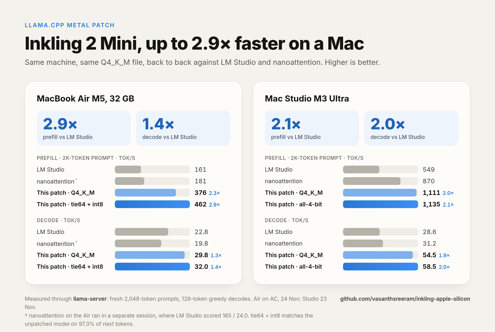
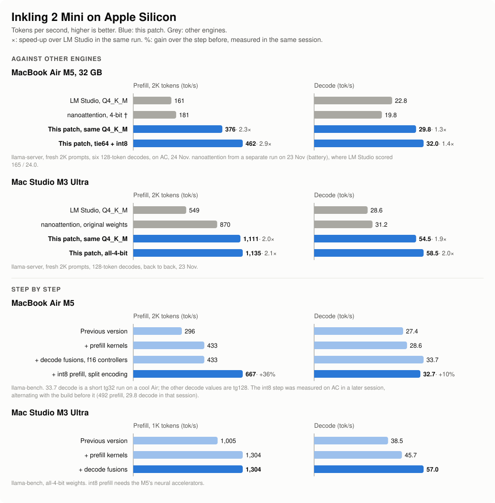

# Inkling 2 Mini on Apple Silicon

Faster local inference for [Thinking Machines' Inkling 2 Mini](https://huggingface.co/thinkingmachines/Inkling-2-Mini) (26B-parameter looped MoE, ~5B active per token) on Apple Silicon Macs, as a patch to llama.cpp's Metal backend.

Inkling isn't a typical MoE. Its middle 12 layers run **three times per token** (48 layer passes), and those passes are tied together by small "loop controller" networks. Stock runtimes handle that badly. This patch adds fused Metal kernels for the parts that are unique to Inkling. Each one is behind an environment flag, and every change was checked against the unpatched model for next-token agreement.

## Results





An interactive version is in `results/comparison.html`; the numbers are in `results/summary.json`, and `scripts/make_charts.py` regenerates both.

### MacBook Air (M5, 32 GB, fanless)

Cool machine, all-4-bit weights (see below), `llama-bench`, tokens/s:

| | Prefill, 1,024 tokens | Prefill, 2,048 tokens | Decode |
|---|---:|---:|---:|
| LM Studio, Q4_K_M (for reference) | ~105 | — | ~21.6 |
| This patch, previous version | 334 | 296 | 27.4 |
| This patch, prefill kernels | 460 (best ~500) | 433 | 28.6 |
| + decode fusions and f16 controllers | 460 | 433 | 33.7 |
| **+ int8 prefill, 64-wide scales, split encoding** | — | **667** | **32.7** |

- Prefill is **~4.4× LM Studio**, and decode is **~1.6× LM Studio**.
- The last row was measured later on AC power, alternating arms in the same session: with the new flags off the same build gave 492 prefill and 30.7 decode, so the like-for-like gains are **+36% prefill** and **+9–10% decode** ([details](results/2026-11-23-int8-prefill.md)). It uses the `tie64` weights described below.
- The 33.7 decode is from short `tg32` runs on a cool Air; the rows above it used `tg128`. Measured the same way just before, the previous build gave 31.6, so the like-for-like gain is **31.6 → 33.7**. GPU time per token drops from ~31.5 to ~29.5 ms (5,440 graph nodes instead of 6,880).
- The Air throttles hard under sustained load. Back-to-back runs drop to roughly 240–320 prefill and 16–20 decode. The relative gains held at that temperature too.
- The decode fusions gain **+7% on the Air** and **+25% on the M3 Ultra**. The Air's slower memory makes kernel overhead a smaller share of each token.

### Mac Studio (M3 Ultra)

| | Prefill, 1,024 tokens | Decode |
|---|---:|---:|
| Patch, previous version | 1,005 | 38.5 |
| + prefill kernels | 1,304 | 45.7 |
| **+ decode fusions (this release)** | **1,304** | **57.0** |

Through `llama-server` (six 128-token greedy requests), decode went from **45.8 to 56.7 tok/s**.

### Against LM Studio and nanoattention

Same machine, back to back, fresh 2K prompts and 128-token decodes ([details and caveats](results/2026-11-23-vs-lmstudio-nanoattention.md)):

| Mac Studio M3 Ultra | Prefill tok/s | Decode tok/s |
|---|---:|---:|
| LM Studio (Q4_K_M) | 549 | 28.6 |
| [nanoattention](https://github.com/justrach/nanoattention) (original checkpoint, best batch) | 870 | 31.2 |
| **This patch (same Q4_K_M)** | **1,111** | **54.5** |
| **This patch (all-4-bit)** | **1,135** | **58.5** |

| MacBook Air M5, warm, same round | Prefill tok/s | Decode tok/s |
|---|---:|---:|
| LM Studio (Q4_K_M) | 81 | 16.2 |
| nanoattention (original checkpoint, batch 128) | 101 | 8.4 |
| **This patch (same Q4_K_M)** | **256** | **25.2** |
| **This patch (all-4-bit)** | **338** | **31.9** |

Later, through `llama-server` on AC power (same Air, back to back): LM Studio **161 / 22.8**, this patch on the same Q4_K_M **376 / 29.8**, this patch on `tie64` with int8 prefill **462 / 32.0** ([details](results/2026-11-23-int8-prefill.md)).

nanoattention runs the original NVFP4/MXFP8 weights, which are higher fidelity than any 4-bit GGUF. On the 32 GB Air that 19.5 GB checkpoint doesn't stay resident and pages from SSD.

### Where decode time goes

A decode token has to read about **3.0 GB of weights**: 1.72 GB of experts (8 of 128 per pass) plus 1.28 GB of everything else. `bench/decode_bench.cpp` runs only those weight-reading matmuls, in model order, at the real types and shapes:

| Decode token | Air (M5) | Studio (M3 Ultra) |
|---|---:|---:|
| Full model, GPU time, before the decode fusions | 33.6 ms | 18.4 ms |
| Weight-reading matmuls alone | 27.1 ms | 11.2 ms |
| **Glue between the matmuls** | **~6.5 ms** | **~7 ms** |

The glue costs about the same absolute time on both machines, so it's per-kernel launch and barrier latency, not memory bandwidth. Before the fusions a token ran ~2,950 kernels with ~2,000 barriers. With them, it runs **2,086 kernels with 1,593 barriers**:

- **Fused loop controllers (`INKLING_CTRL_FUSE`)**: each of the 96 controller applications per token was RMS norm ×2, concat, three tiny matmuls and a merge, about five barriers each. It is now two kernels. These matmuls had been reading their weights at only 72–80 GB/s.
- **Short convolution advances its own state (`INKLING_CONV_STATE`)**: in single-token decode, each of the 192 convolutions per token reads its history from the gathered state copy and writes the shifted window straight back to the cache. That replaces a concat plus a barriered copy, and the arithmetic is unchanged.

The Air's practical ceiling is around **37 tok/s**: 3.0 GB per token at the ~110 GB/s its kernels reach. Going past that means reading fewer bytes, not launching fewer kernels.

### Quality

Every change was compared against the unpatched path on the same weights:

| Change | Check | Result |
|---|---|---|
| Prefill kernels | 8,192 next-token predictions | 99.3% (Air) / 99.5% (Studio) agreement; mean NLL slightly *better* |
| Fused controllers | 8,192 positions, one token at a time (the decode path) | 99.87% agreement; mean NLL 1.03518 → 1.03524 (+0.006%) |
| In-place conv state | same | 100% identical to the controller-only run |
| f16 controllers and routers | 8,192 positions | 100% agreement, identical NLL |
| All-4-bit weights vs original Q4_K_M | against a Q6_K reference | 97.12% → 96.90% agreement; mean NLL +0.4% |
| Full stack via server | 12 short answers, 6 × 128-token greedy | same 11/12 correct; 5/6 continuations identical, one near-tie flips at token 91 |

The disagreements come from floating-point summation order flipping near-ties. None of the changes approximate the model, apart from the optional all-4-bit file.

### int8 prefill on the M5 (W4A8)

The M5's neural accelerators run int8 matmuls faster than f16, so on M5 prefill quantises activations to int8 and multiplies them against the 4-bit weights directly. Q4_K rescales every 32 values, and that rescale reads the accumulator; on its own it limits int8 to about +6% in a standalone matmul benchmark. Rescaling every 64 values gives +37%.

- `INKLING_W4A8` works on any 4-bit file, scale every 32 values: **+11% prefill**, 99.0% next-token agreement.
- `scripts/tie64.py` rewrites a 4-bit file so each pair of 32-value blocks shares one scale. Types and layout stay the same, so every other kernel still reads it. With `INKLING_W4A8_G64`, 64-token tiles (`T64`) and small-expert tiles (`ADAPT`): **+36% prefill** together with `CONV_FUSE`. It costs 97.3% agreement and +1.4% perplexity; that cost comes from the rewritten file, not the int8 maths.
- Splitting graph encoding over two CPU threads (`INKLING_METAL_ENCODERS=2`) hides the ~7 ms the CPU spends encoding each decode token: **+9% decode** on the Air.

```sh
GGUF_PY=build/source/gguf-py python3 scripts/tie64.py weights/Inkling-2-Mini-pure-Q4-ctrl16.gguf weights/Inkling-2-Mini-pure-Q4-tie64.gguf
./serve.sh weights/Inkling-2-Mini-pure-Q4-tie64.gguf
```

`env.sh` enables the 64-wide path only when `INKLING_MODEL` names a `tie64` file (`serve.sh` sets it). On an untied file it must stay off.

### Folded expert scales, split controllers, SiTU inside the int8 quantiser (M5, +16% prefill)

Three more changes on top of the full M5 stack (`patches/inkling-m5-extras.patch`, applied by `build.sh`):

- `scripts/fold_scales.py` folds the per-expert `ffn_{gate_up,down}_exps.scale` tensors, which the NVFP4 checkpoint leaves behind, into the fp16 block scales of the 4-bit expert weights. It then drops them, which removes two MUL passes over every expert output.
- `INKLING_SPLIT_CTRL` computes `concat(a, b) @ W` as `W[:, :n] a + W[:, n:] b`, so the 4,608-wide concat is never built.
- `INKLING_SITU_A8` computes SiTU inside the int8 quantiser of the expert down-projection, so its f32 output is never written or read back. The output is bit-identical to the unfused path.

On an M5 MacBook Air (24 GB), alternating arms with cool-downs: prefill at 2,048 tokens goes from **582 to 675 tok/s**, and decode is unchanged (31.7 → 32.0). Agreement with the unfolded file is 98.9% (mean KLD 0.0010), all of it from fp16 rounding in the fold ([details](results/2026-11-25-fold-split-situ.md)).

```sh
GGUF_PY=build/source/gguf-py python3 scripts/fold_scales.py weights/Inkling-2-Mini-pure-Q4-tie64.gguf weights/Inkling-2-Mini-pure-Q4-tie64-fold.gguf
./serve.sh weights/Inkling-2-Mini-pure-Q4-tie64-fold.gguf
```

**unsloth's `UD-Q4_K_M` keeps 40 expert tensors in NVFP4.** This llama.cpp revision has no Metal path for them, so they run on the CPU: about 23 prefill and 10 decode on the Air. Convert the file first: `make-pure-q4.sh`'s `llama-quantize --allow-requantize` line works directly on it, then run `ctrl_f16.py`, `tie64.py` and `fold_scales.py`.

### Offline coding on 24 GB: `serve-coding.sh` (long context, 26 Nov)

`./serve-coding.sh [CTX] [PORT]` runs the imatrix ctrl16 fold file (97.3% top-token vs the original NVFP4) with:

- `-ctk q8_0 -ctv q4_0` on the Metal GPU (the extras patch fixes two upstream Metal bugs for mixed K/V types) and `INKLING_SWA_KV_F16=1`, which keeps the small sliding-window cache in f16: 99.0% top-token vs f16 KV (98.3% without it), +190 MiB.
- `-lm none`: weights read into memory instead of mmap'd. 128K decode goes from 10.6 to 15.2 tok/s; mmap'd pages fault under memory pressure.
- `--spec-type ngram-mod`: +42% decode on code edits, no loss on new code.

Context on the default GPU cap with other apps closed: 196K (K8V4), or 262K with `-ctk q4_0 -ctv q4_0 -ub 512` (98.6% docs / 98.1% code). A needle test at 244K tokens of code found 3 of 3 planted facts; decode there is 11 tok/s and a first fill takes ~25 min. Details: [layer map and results](results/2026-11-26-layer-map.md); next steps: [ROADMAP.md](ROADMAP.md).

## What didn't work

- **Double-buffered weight loading in the int8 kernels** (`INKLING_W4A8_PIPE`): 17% slower; the extra threadgroup memory cuts how many work-groups fit per GPU core.
- **Speculative decoding** with the model's own DSpark drafter: slower on the Air. Verifying k drafted tokens reads almost k times the expert weights, because 128 experts barely overlap, and only 45–59% of drafts are accepted.
- **MLX (oMLX runtime)**: 80–105 prefill and 3–8 decode on the same Air. The Air was swapping during that run, so treat it as a floor, not a fair comparison.
- **Core ML / ANE** for the controllers and draft projections: the planner placed single-token work on the CPU.

## Use it

```sh
./build.sh                                   # fetches llama.cpp @ 0a9105de, applies the patch, builds bin/
./serve.sh /path/to/Inkling-2-Mini-Q4_K_M.gguf   # OpenAI-compatible server on 127.0.0.1:18766
```

Benchmark:

```sh
. ./env.sh
bin/llama-bench -m MODEL.gguf -fa 1 -ub 1024 -p 1024,2048 -n 128
```

`env.sh` turns on the recommended flags, and on an M5 adds the expert-tile kernel, int8 prefill and split encoding. With no flags set, the binary behaves like upstream llama.cpp.

### All-4-bit weights (optional, ~10–14% faster decode)

The Q4_K_M recipe keeps the expert down-projections at Q8_0/Q5_0 and the output head at Q6_K. Making them 4-bit cuts the file from 17.5 to 14.8 GB. Storing the f32 loop controllers and routers as f16 is free (100% agreement) and saves another 142 MB read per token:

```sh
./scripts/make-pure-q4.sh Inkling-2-Mini-Q8_0.gguf ./weights
```

## Flags

| Flag | Effect | Phase |
|---|---|---|
| `INKLING_SITU`, `INKLING_CLIP`, `INKLING_GATE_MERGE`, `INKLING_SHORTCONV` | Fused SiTU activation, QK clipping, controller gate merge and 4-tap convolution | both |
| `INKLING_REL_MASK`, `INKLING_DEPTH_CACHE` | Relative-position mask, depth norms computed once | both |
| `INKLING_DEPTH_MIX`, `INKLING_REL_BIAS` | Fused depth attention; relative bias folded into the attention mask | prefill |
| `INKLING_MOE64=32`, `INKLING_MOE64_WS=1` | M5: 64-token expert tiles, 4 SIMD groups dequantise while 4 run the matmul | prefill |
| `INKLING_CTRL_FUSE`, `INKLING_CONV_STATE` | Decode fusions described above | decode |
| `INKLING_W4A8` | M5: int8 activations × 4-bit weights on the neural accelerators, scale every 32 values | prefill |
| `INKLING_W4A8_G64`, `INKLING_W4A8_T64`, `INKLING_W4A8_ADAPT` | M5, `tie64` files only: scale every 64 values, 64-token tiles, 32-token tiles for experts with ≤32 tokens | prefill |
| `INKLING_CONV_FUSE` | Prefill short convolution reads its saved state and input directly; bit-identical | prefill |
| `INKLING_METAL_ENCODERS=2` | Encode each graph on two CPU threads so encoding overlaps GPU work | decode |
| `INKLING_OP_PROFILE=2` | Time every kernel group in prefill-sized graphs and print a ranked table | diagnostics |
| `INKLING_ORDER` | Emits independent kernels (q/k/v controllers, norms, projections) next to each other so they share barriers; bit-identical output, +5% decode on M3 Ultra | both |
| `INKLING_METAL_TIMING` | Print nodes, encode time and GPU time per graph | diagnostics |
| `INKLING_SPLIT_CTRL` | Loop-controller down-projection as two half-width matmuls instead of concat + matmul | both |
| `INKLING_SITU_A8` | M5, `tie64` files: SiTU computed in the int8 quantiser of the expert down-projection; bit-identical | prefill |
| `INKLING_OP_PROFILE_NAMES` | With `OP_PROFILE`, key non-matmul ops by tensor name | diagnostics |
| Others in the patch (`W4A8_PIPE`, `NAX_TILE`, `ROUTE_MAP`, `PAIRED_GATES`, …) | Experiments kept for reproducibility; no gain measured | — |

## Repository

- `patches/inkling-apple-silicon.patch`: the complete change against `ggml-org/llama.cpp@0a9105de42d2c3e3cbc72cb1f398c743ada4f342`
- `patches/inkling-m5-extras.patch`: split controllers, SiTU-in-quantiser, GPU mixed K/V cache, SWA cache in f16, `REL_FA` short-prompt fix; applied on top by `build.sh`
- `serve-coding.sh`: long-context coding server; `ROADMAP.md`: status and next steps
- `scripts/fold_scales.py`: folds per-expert output scales into the 4-bit block scales
- `bench/decode_bench.cpp`: the matmul-only decode token
- `bench/score_tokens.cpp`, `scripts/compare_tokens.py`: next-token agreement and NLL between two builds or files
- `bench/corpus/gsm8k-sample.txt`: scoring corpus, a sample from [GSM8K](https://github.com/openai/grade-school-math) (MIT)
- `scripts/model_bytes.py`: bytes read per decode token from a GGUF header
- `scripts/make-pure-q4.sh`, `scripts/ctrl_f16.py`: the all-4-bit and f16-controller conversions
- `scripts/tie64.py`: shares one scale per 64 values for the M5 int8 prefill path
- `results/`: raw numbers behind the tables

## Status

- The patch targets one pinned llama.cpp revision and has not been sent upstream.

## Method notes

- On the fanless Air, heat moves results by up to 2×, more than most optimisations. Comparisons there alternate before/after runs with cool-downs in between, and always use a single model file, since two 15 GB files on 32 GB evict each other.
- Bandwidth figures come from Metal copy microbenchmarks: 123–131 GB/s on a cool Air, ~115 GB/s sustained.

## License

MIT. The patch modifies llama.cpp (MIT, © the ggml authors). Model weights aren't included; get them from their publishers under their own terms.
