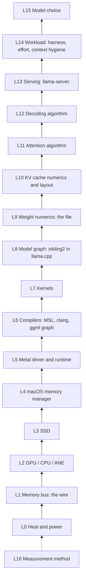

# Layer map: every layer between the silicon and the task, for Inkling 2 Mini on the M5 Air 24 GB (26 Nov 2026)

Goals: speed, no quality loss, more context (256K → 1M). Use case: offline coding (flights) and this project.
Numbers are measured unless marked *estimate*. "Done" = measured and in `env.sh`/the patch.

## Results of the first round (26 Nov, 08:14–10:45; logs `runs/chain6_*` … `runs/chain9b_*`)

| Test | Result | Adopted |
|---|---|---|
| A2 SWA cache in f16 (`INKLING_SWA_KV_F16`), same top vs f16 KV | K8V4: docs 98.30 → **99.01%**, code 97.99 → **98.50%**; q4/q4: docs 98.01 → 98.63%, code 98.05 → 98.13%. +190 MiB at 192K | yes, `env.sh` |
| A1 multi-turn prompt cache | Turns 2–4 read 16–19 new tokens (reasoning kept); 142 then ~22 (reasoning dropped) | works, nothing to change |
| A3 speculative types (tok/s, edit / fresh code) | none 26.2 / 21.2; DSpark 26.0 / 17.6; **ngram-mod 37.1 / 21.1**; both 48.0 / 19.0. Greedy outputs differ between arms (float rounding in batched verify) | ngram-mod in `serve-coding.sh` |
| B1 GQA heads as rows (`INKLING_FA_GQA_ROWS`) | Bit-identical (KLD 0), but no gain: 64K 16.3 → 15.0, 128K 13.2 → 13.0 | no (flag stays off) |
| Clean decode timing | d=0 GPU 27.5 ms/token (35.0 tok/s); 64K 40.3 ms (23.2 tok/s): attention reads the K8V4 cache about once (~68 GB/s) | — |
| Weights in memory vs mmap (`-lm none`), 128K tg16, 2 runs each in opposite orders | mmap 11.4 / 9.7; **none 14.9 / 15.4 (+44%)**; depth 0 unchanged (pp 584 vs 581, tg 36.0 vs 34.8) | yes, `serve-coding.sh` |

## Second round: the longest context that works (26 Nov, 10:50–14:51)

| Test | Result |
|---|---|
| Max context that loads (server start + request, all apps closed, default ~18.2 GB GPU cap) | K8V4 + SWA f16, ub 1024: **196,608** (18,058 of 18,186 MiB). q4/q4 + SWA f16, ub 512: **262,144** (17,769 MiB). 229K K8V4 and 327K q4/q4 fail |
| Cost of `-ub 512` (ABBA, q4/q4) | Prefill −4% (607 → 580 at d=0; 391 → 379 at 32K); decode unchanged |
| 256K end to end (fill 258,048 tokens, q4/q4 + SWA f16, `-lm none`, ub 512) | pp512 at that depth 76.8 tok/s, decode 11.1 tok/s (GPU 91–93 ms/token, no stall outside the GPU); peak RSS 18.1 GB |
| Needle test: 243,649 tokens of llama.cpp source, 3 planted facts at 10/50/90% depth, one question | **All 3 answered exactly.** Prompt read 1,514 s (164 tok/s mean); decode 11.0 tok/s |
| KV quantization at depth: KLD vs f16 KV on one 65,536-token code chunk | K8V4 + SWA f16 **99.24%** / 0.0018; q4/q4 + SWA f16 **99.10%** / 0.0024. No extra loss at depth |

Speed against depth is linear in time per token (q4/q4 + SWA f16, `-lm none`; fit within ~10–15%):

| | Model | 0 | 64K | 128K | 256K |
|---|---|---:|---:|---:|---:|
| Decode, ms/token | 28 + 0.24 × K | 36 tok/s | 23 | 17 | 11 |
| Prefill, ms/token at depth K | 1.65 + 0.044 × K | 606 tok/s | 230 | 137 | 79 |
| Time to fill N tokens | 1.65·N/1000 + 0.022·(N/1000)² s | | 3 min | 8 min | 28 min |

K = depth in thousands of tokens. The decode slope (0.24 ms per 1K) is ~2.6× what bandwidth alone allows for a q4/q4
cache (~0.09); with K8V4 at 64K it is ~68% of the bus. q4_0 dequant in the vec kernel is the likely limit (not measured).

**Correction.** The "K/V work done once per query head, ~2× too slow" finding below was wrong. It rested on long-context
numbers measured while the Mac was swapping. Clean runs show the attention kernel near the bus, B1 gained nothing, and
the real long-context loss was page faults on memory-mapped weights (fixed by `-lm none`). The open PR #30728's
M4 Pro data (no gain with q8_0) was consistent with this.

## Where the bytes go: one decoded token reads 2.92 GB

From the GGUF tensor sizes (`imx-Q4-ctrl16-fold`): 8 of 128 experts per pass; layers 6–17 run 3 times (48 passes).

| Part | Bytes per token | Share | Shared across a speculative batch? |
|---|---:|---:|---|
| Experts (gate/up Q4_K, down IQ4_NL) | 1.72 GB | 59% | no: each token picks its own 8 experts |
| Attention projections (q, gate, o, k, v, rel) | 0.72 GB | 25% | yes |
| Output head (201K vocab × 2304, Q4_K) | 0.26 GB | 9% | yes |
| Loop controllers (F16) | 0.17 GB | 6% | yes |
| Router (F16) | 0.03 GB | 1% | yes |

34.8 tok/s × 2.92 GB ≈ 102 GB/s achieved, against a 153 GB/s spec. This is why speculative decoding gives only +14%:
the 59% expert share is not shared across draft tokens.

Context adds, per token of context, 13.3 KB (K8V4) read on every decode step. Measured K8V4 decode: 32K 27.1, 64K 14.7,
128K 12.7, 192K 8.6 tok/s. That is about 2× slower than the bytes alone predict: the decode attention kernel does its K/V
work once per *query* head (24) instead of once per KV head (8) (`fa_vec_common.metal`: one threadgroup per `iq2`).

## The layers

| Layer | What it is here | Measured state | Levers (status) |
|---|---|---|---|
| **L0 Heat and power** | Fanless; AC or battery | Heat moves results 15–20% | Energy per token on battery (flights): not measured yet. Cool, hard surface; Low Power Mode off |
| **L1 Memory bus** | LPDDR5X, 153 GB/s spec ([Apple](https://support.apple.com/en-us/126320)); 24 GB | ~102 GB/s in decode | Hard wall for decode. Only fewer bytes per token or more tokens per read help |
| **L2 Compute units** | GPU 10 cores with neural accelerators; CPU 4P+6E; 16-core ANE | Experts in prefill reach ~9.4 TOPS int8; FA at depth reaches ~2–3 TFLOPS (*computed from timings*) | ANE and CPU share the same bus, so no gain for decode. The ANE for prefill is research-grade only |
| **L3 SSD** | 3.8 GB/s sequential, 3.15 GB/s random 1 MiB | 35× slower than RAM | Context save/restore (done: 0.1 s vs 14 s). Streaming experts from SSD: ruled out (decode collapses) |
| **L4 macOS memory** | Wired GPU cap (`iogpu.wired_limit_mb=0` means the default ~18.2 GB); compressor; swap; mmap'd weights | Swap 3.4 GB used during benchmarks; the 192K run swapped 6.1 GB | Raise the cap (sudo, resets on reboot): +~100K context. Close apps. `--mlock`. **the user's call** |
| **L5 Metal runtime** | Command buffers, 2 encoders, barriers, residency | 5,512 dispatches per decode token; 28.1 ms GPU time vs ~24 ms at 120 GB/s | Fewer dispatches and barriers (B3). Indirect command buffers to replay the decode graph |
| **L6 Compilers** | MSL→AIR→GPU (function constants, register pressure); host clang; ggml graph fusion and ordering | Author's `ORDER`, our split/SiTU fusions | More fusion in the ggml-metal fusion pass. Alternative stacks (MLX `mx.compile`, Core ML): only if a port of Inkling exists (unchecked) |
| **L7 Kernels** | Decode GEMV (Q4_K, IQ4_NL); prefill W4A8 int8; FA vec (decode); FA tensor (prefill); small ops | See above | **B1** shared-dequant GQA decode attention; **B2** FA at depth (prefill); **B3** small-op fusion; **B4** NVFP4 kernels |
| **L8 Model graph** | inkling2 in llama.cpp | 11,744 → 6,208 nodes per prefill graph (author + ours) | Controllers stay F16 (170 MB/token) for quality. Remaining small-op fusion (B3) |
| **L9 Weight numerics** | imatrix Q4_K/IQ4_NL, ctrl16 or tie64, fold | 97.3% same top token vs original NVFP4 (ctrl16), 96.5% (tie64) | **B4**: exact NVFP4. E2M1 × E4M3 products are exact in fp16, so an fp16 path holds the original weights bit-for-bit. Layers 6–17 run 3×: bits there buy ~3× the quality per GB of RAM |
| **L10 KV numerics/layout** | Global (8 passes) and SWA (40 passes, window 1024); Hadamard rotation per cache | K8V4 98.3%; q8/q8 99.0%; q4/q4 97.4–98.1% | **A2 (queued)**: SWA cache in f16 (+~150 MB) while global stays quantized; may lift q4/q4 over 98% (→ ~240K, ~380K with cap) |
| **L11 Attention algorithm** | Dense exact attention | Prefill at 128K depth: 116 tok/s; 192K: 97 | Sparse top-k pages over the 8 global passes (lever 7) is the only route to 1M. Not exact; prior-art scan first |
| **L12 Decoding** | Greedy or sampled; speculative | DSpark +14% short ctx | **A3 (queued)**: n-gram drafting (`ngram-mod`, in our binary) for code edits that copy text, alone and with DSpark. Draft batches also share KV reads, so gains should grow with depth |
| **L13 Serving** | llama-server: prompt cache, 32 SWA checkpoints per slot, slot files, `-np` | Slot restore 0.1 s | **A1 (queued)**: does turn N+1 re-read only new tokens (client keeps vs drops reasoning)? `-np 2–4` for parallel local agents: est. +30–50% total throughput |
| **L14 Workload** | Harness system prompt, thinking effort, context length | Template default effort 0.9 ("high") | Effort per task (none → max) is the largest wall-clock lever for coding; quality per task is the user's call. Keep sessions under ~32K where decode is ~27 tok/s |
| **L15 Model choice** | Inkling vs Gemma 4 26B-A4B and others | Out of scope for this repo | Expert pruning (REAP-style) would save RAM but changes the model; only if KLD shows no loss |
| **L16 Measurement** | ABBA, cool-downs, KLD | KLD corpus was prose and docs | A code corpus is added in A2. Measure true bus ceiling with a read benchmark; log heat state |

## Ranked next moves

| # | Move | Goal served | Effort | Expected (*estimate*) |
|---|---|---|---|---|
| A1–A3 | Queued in `runs/chain6.sh` (runs after run9_night) | all three | 45 min of GPU | decides SWA-f16, spec type for coding, cache reuse |
| B1 | Shared-dequant GQA decode attention: one threadgroup per KV head, dequantize each K/V chunk once into threadgroup memory for its 3 query heads. Builds on open PR [#30728](https://github.com/ggml-org/llama.cpp/pull/30728) (bundling only; an M4 Pro test showed no gain with q8_0 because dequant, not reads, binds) | speed at long ctx, exact | 1–2 days | 128K decode 12.7 → ~18–22 tok/s |
| B2 | Profile FA prefill at 64K/128K depth (`OP_PROFILE`), then tile and GQA tuning | speed at long ctx, exact | 0.5 day to profile | unknown until profiled |
| B3 | Decode dispatch fusion | short-ctx decode, exact | days | 34.8 → up to ~40 tok/s (bus floor ~41) |
| B4 | NVFP4 experts on the GPU in this stack (fp16-exact path) | quality → original | ~1 week | 97.3% → ~99% top-token; decode same; prefill slower unless hybrid |
| C1 | Raise the GPU cap | context | 1 command | ~200K → ~300K (K8V4) |
| D1 | Sparse global attention | context → 1M | weeks, research | 1M only this way |

## The seven levers from 25 Nov, now

| # | Lever | Status |
|---|---|---|
| 1 | 4-bit KV + `REL_FA` | Done partly: K8V4 on GPU at 98.3% after fixing two upstream Metal bugs; q4/q4 just under 98% (A2 may fix) |
| 2 | Raise GPU cap | Not done: needs sudo, the user's call |
| 3 | Save context to SSD | Done: 0.1 s restore vs 14 s |
| 4 | DSpark | Done at short ctx (+14%); long ctx and n-gram queued (A3) |
| 5 | Original NVFP4 on GPU | Master runs it, slower (191/23). Requant with imatrix instead (97.3%). Reopened as B4 by the fp16-exactness point |
| 6 | Decode fusion | Not started (B3) |
| 7 | Sparse retrieval for 1M | Not started (D1) |

Ruled out, with reason: SSD expert streaming (decode collapses); 3-bit experts (quality); CPU+GPU split decode (same bus);
ANE for the main model (same bus, immature tooling); trimming the output vocabulary (changes outputs); sharing KV across loop
passes (changes the model).
